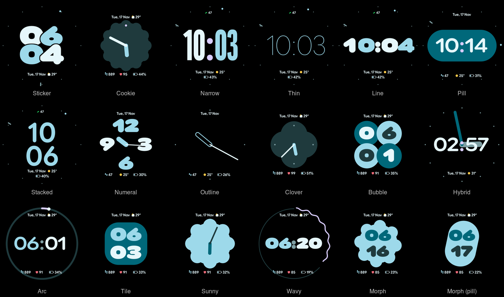
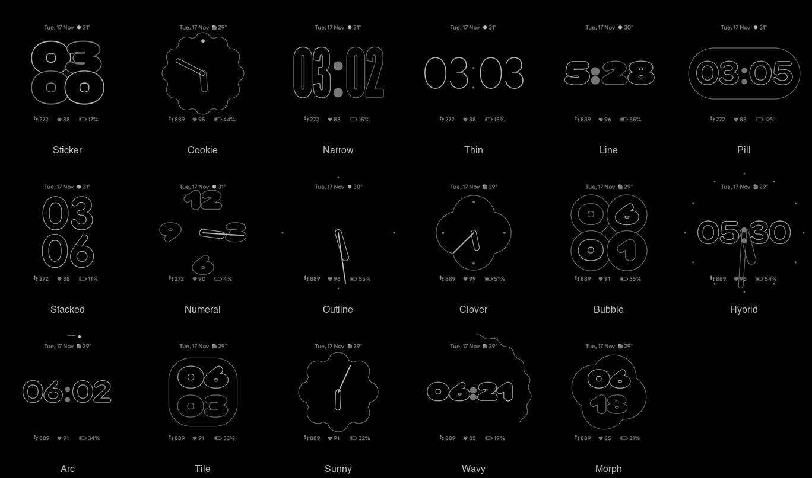

# Clock Styles

A Wear OS watch face with 17 clock styles, written in Watch Face Format (WFF v2). There is no app code: `gen.py` writes the face's XML and `build.sh` packs it into an APK.

Built and tested on a Galaxy Watch 6 Classic (Wear OS 5, Samsung's WFF renderer).



## Styles

| # | Style | What it is |
|---|---|---|
| 0 | Sticker | Heavy hours over minutes, overlapping digits with outlines |
| 1 | Cookie | Pill hands on a 12-scallop cookie dial |
| 2 | Narrow | Tall condensed time on one line |
| 3 | Thin | Hairline time |
| 4 | Line | Heavy one-line time, alternating digit tones |
| 5 | Pill | Time inside a capsule |
| 6 | Stacked | Plain hours over minutes |
| 7 | Numeral | Analogue with big 12, 3, 6, 9 |
| 8 | Outline | Analogue, outlined hour hand, four marks |
| 9 | Clover | Analogue on a four-leaf dial |
| 10 | Bubble | One digit in each of four overlapping circles |
| 11 | Hybrid | Digital time over slim analogue hands |
| 12 | Arc | Digital time, an arc fills with the minutes |
| 13 | Tile | Stacked time on a rounded square |
| 14 | Sunny | Dark hands on a bright eight-point burst |
| 15 | Wavy | The minutes as a wavy line round the edge |
| 16 | Morph | The time inside a shape that changes every hour and turns slowly |

## Options (long-press the face, then Customize)

- **Color:** seven themes plus Mono.
- **Analog ring:** a quiet analogue time round the edge, behind any style. Off by default.
- **Background:** None, Glow, Blobs, Horizon, Rings, Dither, or a photo you pick on the phone.
- **Info:** the date (default), date and weather, Full (date and weather on top; steps, heart rate and battery at the bottom), Full at the bottom, or Off.

Weather, steps, heart rate and battery are built into the face, so there are no complication slots to set up. Heart rate asks for the body sensors permission.

## Always-on and battery

Always-on draws each style as grey outlines. At 20% battery or less the face switches to that look while awake too, as a power saver.



## Install

Download `clockstyles.apk` from [Releases](../../releases/latest), turn on Wireless debugging on the watch, then:

```bash
adb connect <watch-ip>:<port>
adb install clockstyles.apk
```

Then long-press the current face and pick Clock Styles.

## Build

Needs Python 3 and the Android SDK build tools 34.

```bash
./gen.py
./build.sh
```

`build.sh` creates a signing key on first run. `gen.py --only N` builds a single style and `tools/shoot_styles.sh` takes a screenshot of each style on a connected watch.

## Samsung renderer notes

Things that behaved differently from the WFF docs on Samsung's renderer:

- `DigitalClock` and `TimeText` draw nothing. Use `PartText` with `[HOUR_*]` and `[MINUTE_Z]`.
- A `%` in any string resource breaks the face picker.
- Every `ListConfiguration` and `BooleanConfiguration` must appear once, at Scene level. Repeating or nesting them crashes the Customize editor.
- A `PhotosConfiguration` without a `<Photos>` element in the scene stops the face loading.
- `tintColor` and font `Outline` are ignored, so outlines here are eight offset copies of the text.
- `<Arc>` with a `<Transform>` on `startAngle` or `endAngle` works, which is how Arc and Wavy draw progress.

## License

Code is MIT. The fonts in `res/font` are cut from Google Sans Flex and stay under the SIL Open Font License (`licenses/`).
